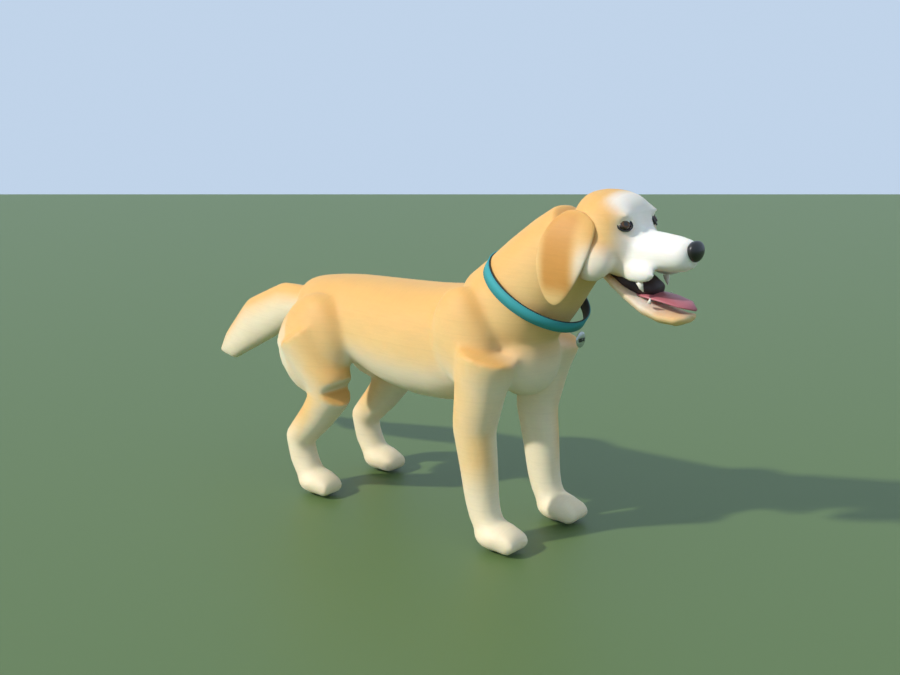
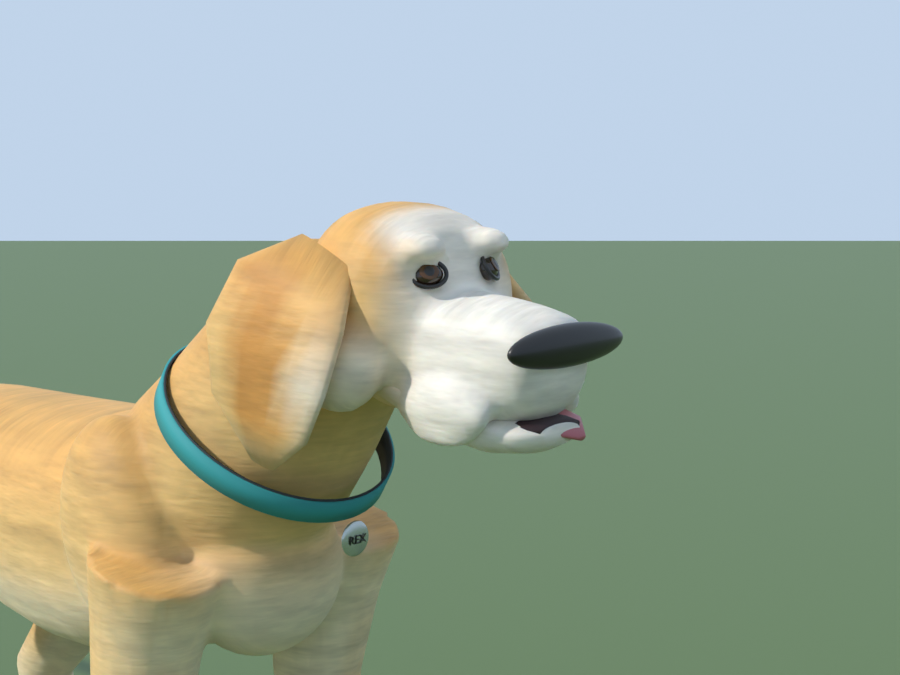
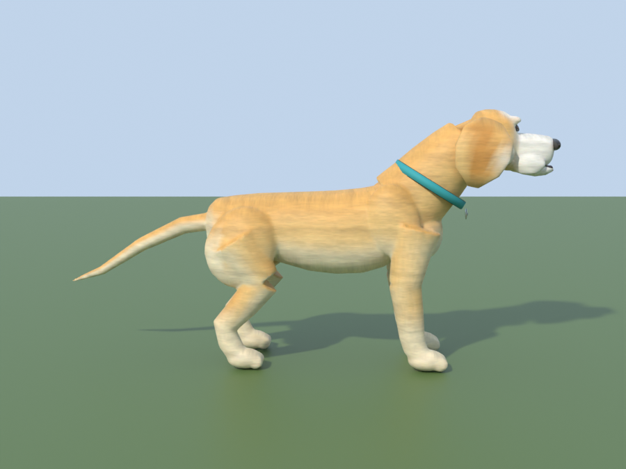

# Rex companion asset

The release uses an original, locally authored golden-dog fallback rebuilt on 2026-10-11. Its golden coat, pale muzzle and brow, hanging ears, dark nose and teal collar are guided by the owner's photographs of Rex. The result remains a stylized prototype; photographic likeness is not achieved.

The earlier Hunyuan3D-derived revision 7 was retired because its output licence does not meet the project's unrestricted commercial-use requirement. Its generated GLB, photo-baked albedo and generated source scene are no longer part of the current asset set. The hosted-generation client was removed. Historical generator/importer scripts stop immediately and direct users to the original pipeline below. This does not rewrite prior Git history.

## Offline pipeline

1. [Tools/create_companion_dog_v2.py](../../Tools/create_companion_dog_v2.py) builds the anatomy from authored lofts and shapes in Blender 4.5. It never opens or uploads a photograph, generated model or photo-derived texture. Coat zoning uses authored vertex colours; fur relief textures are generated numerically.
2. The source mesh has **45,442 triangles**, **24 bones**, ten active material slots and at most four bone influences per vertex. Coordinates are centimetres, +X forward, +Z up, with a ground-level root and no root motion. Shell fur is disabled; feathering cards are an opt-in authoring experiment (`--cards`), disabled for the release.
3. The existing idle and planted-foot walk are authored locally. Walk stride is **0.60185185 m per 13/30-second cycle**, matching 5 km/h. The runtime asset paths, skeleton names and rules remain unchanged.
4. [Source/validate.py](Source/validate.py) round-trips the FBX exports through Blender and checks bone names, normalized weights, material slots, export hashes, clip durations and loop continuity. Results are in [source_validation.json](source_validation.json).
5. [Tools/import_companion_dog_v2.py](../../Tools/import_companion_dog_v2.py) imports the mesh, three LODs and clips to `/Game/Art/CompanionDog`. The opaque default-lit coat uses the authored vertex colours and procedural detail. Unused material slots retained by Unreal reimport are bound to the original coat so that retired texture dependencies cannot survive in the active mesh.

## Files

| File | Purpose |
| --- | --- |
| [Source/CompanionDog.blend](Source/CompanionDog.blend) | Rebuilt original mesh, rig, actions and review scene |
| [Source/likeness.py](Source/likeness.py) | Original walk authoring and stride metadata |
| [Source/render_v5.py](Source/render_v5.py) | Offline review renders (`--quick`, `--views=`) |
| [dog_manifest.json](dog_manifest.json) | Source dimensions, bones, materials, timing and export hashes |
| [import_report.json](import_report.json) | Current Unreal import verification |
| [TEXTURE_PROVENANCE.md](TEXTURE_PROVENANCE.md) | Texture origin and retired-asset record |

Exports under `Exports/` are regenerated and ignored by Git. The source scene and runtime assets are ordinary Git binaries. All current previews were regenerated from the original source; they are Blender previews, not evidence of packaged-game performance.

## Remaining art work

The face, ear attachment, leg contours and smooth coat still need a dedicated likeness pass. This fallback preserves Rex's gameplay and avoids shipping the incompatible generated asset; it does not claim to satisfy the requested realism. Runtime review uses `-GraphicsBenchmark -BenchmarkView=rex` with optional zoom, yaw and pitch overrides.

