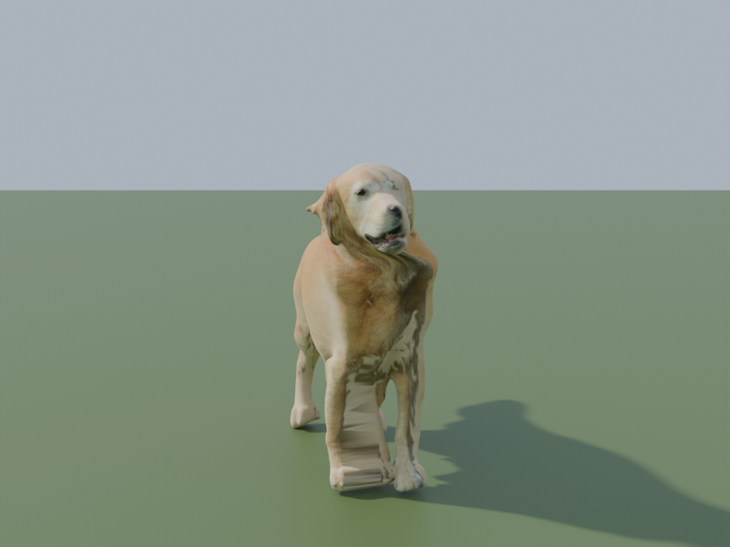
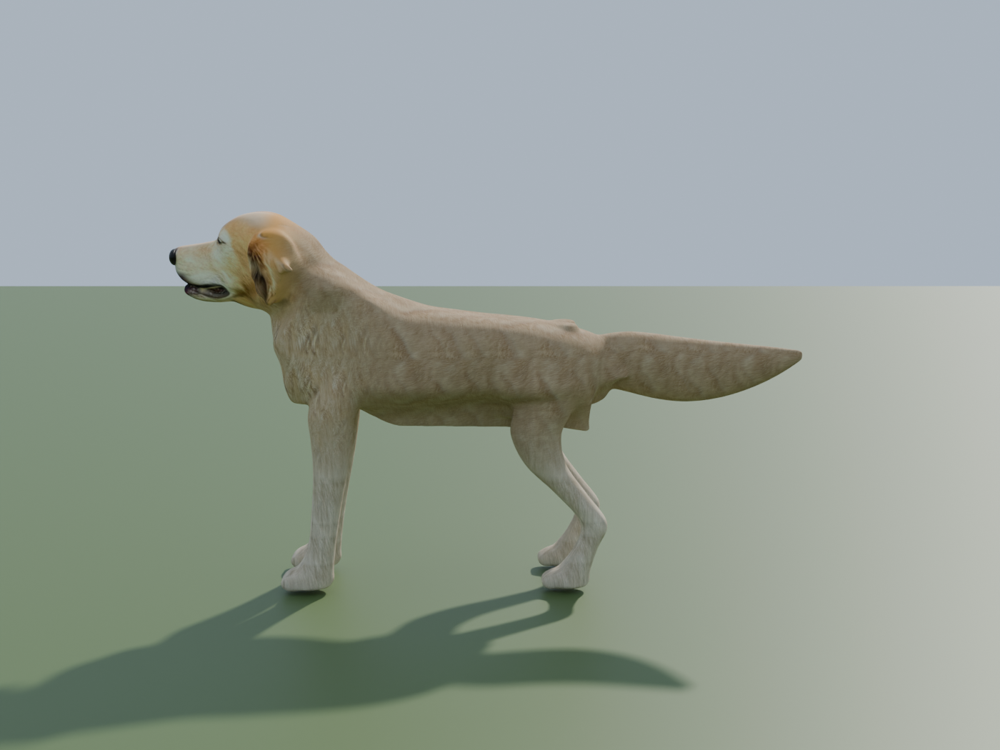
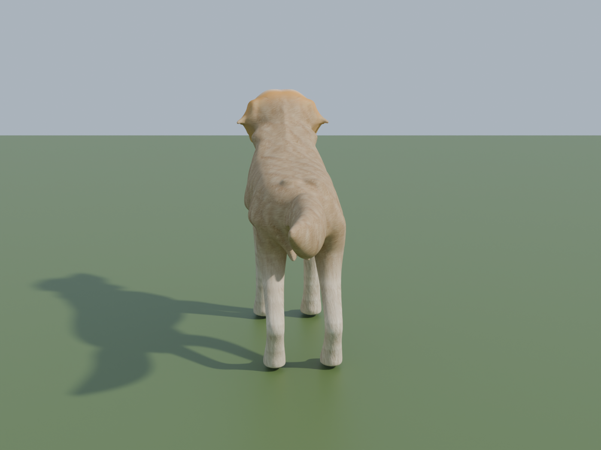
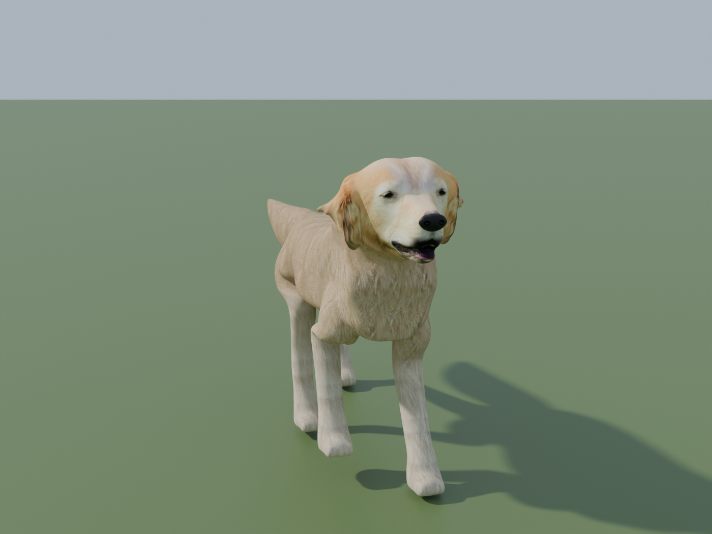
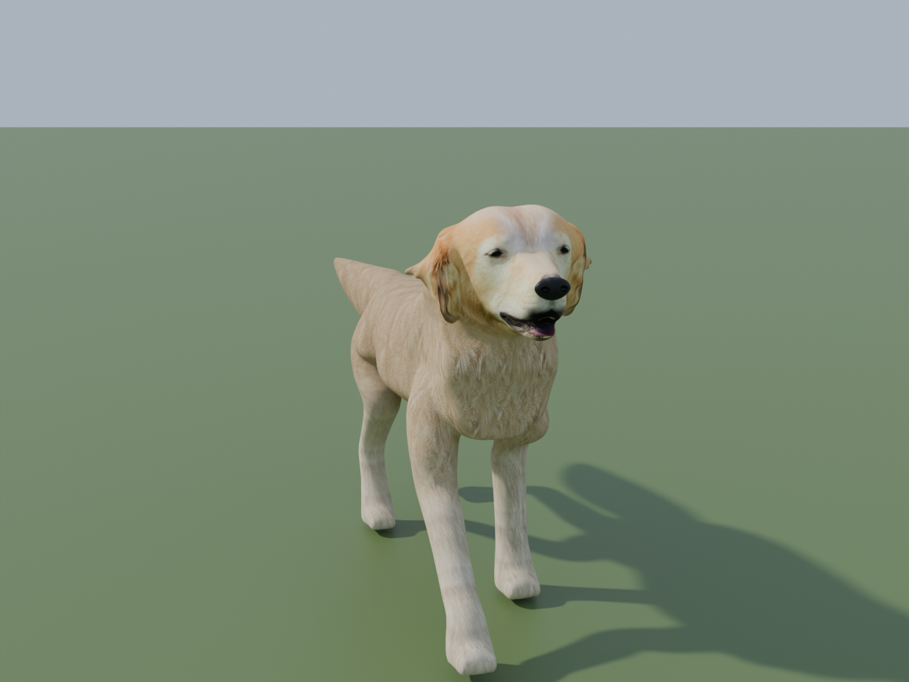
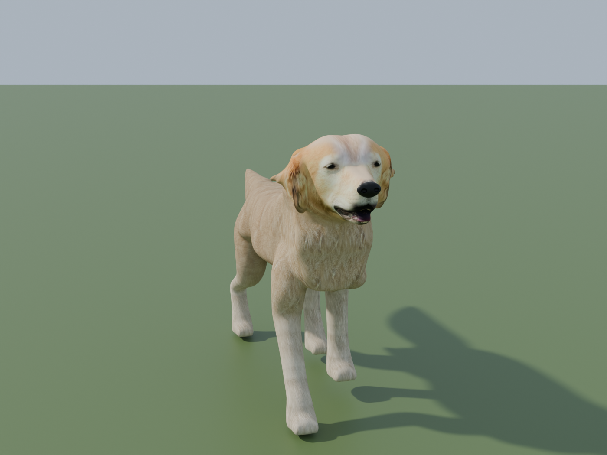

# Rex companion asset

The current **revision 8** repairs the retained detailed Rex model using the owner's five reference photographs. It replaces fused lower limbs and malformed paws with closed anatomical geometry, rounds the split tail, reconstructs the occluded face from the sound side, and rebakes the coat with frontal face projection and normalized photographic fur patches. Continuous limb and tail attachment weights replace the discontinuous weights that folded the chest and rump during walking.

This is a prototype likeness correction. The close silhouette, fur feathering and joint shapes remain simplified; the coat uses textured surfaces, not individual strands. It should not be described as finished photoreal character art.

## Unresolved prototype license exception

The owner explicitly requested temporary use of the earlier detailed Hunyuan3D-2.1-derived base despite the unresolved territorial restriction. The official license section 5(c) covers outputs as well as model materials; the EU, UK and South Korea are outside the defined territory. Attribution does **not** resolve that issue. No commercial or distribution clearance is asserted. See [provenance](TEXTURE_PROVENANCE.md). This repair runs offline and performs no new generation request or photograph upload.

## Current source and runtime contract

- `Source/CompanionDog.blend`: reviewed repaired mesh, two materials, rig and idle/walk/run actions; **93,124 triangles and 24 bones**.
- `Source/RepairDonor.blend`: immutable revision-7 input, retained before repair. Its geometry and UVs must be paired with `Source/PhotoPatches/ReferenceCoat.png`, never the new atlas.
- `Source/PhotoPatches/`: cropped face/nose samples and lighting-normalized fur tiles derived from the owner's references. The original full photographs are not repository assets.
- `Textures/T_Dog_Albedo.png`: 4096-square sRGB atlas. Selected-to-active emission ray transfer preserves valid original facial details without crossing source UV islands; a local front-photo projection corrects the forehead/mouth, and photo fur patches cover rebuilt anatomy.
- `Textures/T_Dog_CoatNormal.png`: 2048-square tangent-space map baked from the same photographic fur clumps on UV0; Unreal flips its green channel to DirectX convention. The facial region remains neutral.
- `Textures/T_Dog_Nose.png`: 512-square photo-derived nose map on separately modeled nostril geometry.
- Runtime paths are `/Game/Art/CompanionDog/SK_CompanionDog`, `A_DogIdle`, `A_DogWalk`, `A_DogRun` and `BS_DogLocomotion`. Coordinates are centimeters, +X forward, +Z up, actor scale 1, with no root motion.
- Idle remains 3 seconds. The 60 fps four-beat walk is 0.5 seconds / 0.70 meters per cycle; the running diagonal trot is 1/3 seconds / 1.30 meters. Planted paws move backward at the physical travel rate; swing trajectories match their velocity at toe-off and touchdown. The locomotion blend space uses physical speeds 0, 5/3.6 and 14/3.6 meters/second. Runtime supplies actual speed and distance-based phase.
- `M_Coat` samples the UV-baked photographic fur; it no longer projects fur from the moving world position. The matched tangent normal follows the final fur direction, with reduced strength. BC7 color compression preserves coat variation; these small character maps remain resident with zero texture LOD bias. The nose has its own photographic material.

## Reproducible offline workflow

Use Python with Pillow/numpy and Blender 4.5 in the repository root, in this order:

```text
python Tools/prepare_rex_coat_tiles.py
blender -b -P Tools/rebuild_rex_anatomy.py
blender -b -P Tools/bake_rex_photos.py
blender -b -P Tools/reweight_rex.py
blender -b -P Tools/validate_rex_deformation.py
blender -b -P Tools/export_rex_repair.py
blender -b -P Tools/export_rex_clips.py
blender -b -P Tools/polish_rex_coat.py
blender -b -P Tools/promote_rex_coat.py
blender -b -P Art/CompanionDog/Source/validate.py
```

The anatomy steps write candidates and previews under `Saved/rex-repair-v011`. The final coat stage writes `Saved/rex-coat-polish`; review it before `promote_rex_coat.py`. All source inputs are retained under `Source/`, so Saved contains reproducible intermediates rather than unique required inputs. Inspect the front, both sides, rear and three walking poses before running the exporter. The exporter promotes the reviewed mesh/textures/previews and regenerates its ignored FBX. Existing animation FBX files can be regenerated from the final source with `Tools/export_rex_clips.py`. Import with `Tools/import_companion_dog_v3.py` in an Unreal Python commandlet; it checks bones, dimensions, materials, animation lengths and three skeletal LODs.

`build_rex_from_generated.py` and `clean_rex_mesh.py` are historical base/restoration tools. They are not the current repair pipeline and overwrite the repaired asset if invoked directly.

For animation-only updates, run `blender -b -P Tools/author_rex_locomotion.py`, then `Tools/import_rex_locomotion.py` in an Unreal Python commandlet using the current compiled Editor target. This preserves the retained mesh, materials, UVs and skin weights, exports the two locomotion clips, and creates the idle/walk/run blend space. The Editor-only `Seige.RebuildRexBlendSpace` command builds the native interpolation cache and checks six runtime speed inputs; Python sample assignment alone does not build that cache. The speed axis ends at 4 m/s to keep the 14 km/h sample inside its float-precision bound. The animation importer checks that all retained non-animation runtime assets, including the skeleton, remain byte-identical. It does not rerun the photographic or mesh import pipeline. `Tools/export_rex_clips.py` respects each clip's authored sample rate when regenerating exports.

## Verification

`coat_polish_validation.json` records an exact geometry/UV/weight hash proving that the final coat pass did not change anatomy. The color bake retains real photographic fur clumps, blends non-mirrored samples to limit repetition, and follows downward chest/leg fur flow. Its preview uses the actual baked normal, not an unexported procedural bump.

The retained anatomy evidence predates the locomotion update: `deformation_validation.json` checks every frame of the original 13-frame walk plus its repeat frame; `source_validation.json` checks that original FBX round trip, bones, materials and hashes; `import_report.json` records its Unreal import. For the current gait update, `dog_manifest.json` records exact loop continuity and IK target error at every authored frame, and `locomotion_import_report.json` records clip durations, stride lengths, blend-space samples, and preservation of the runtime mesh/skeleton/materials. Four source poses were visually checked during the update; this does not establish a rendered in-game playthrough.








