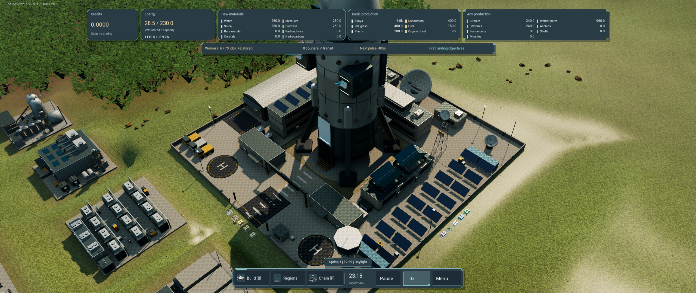
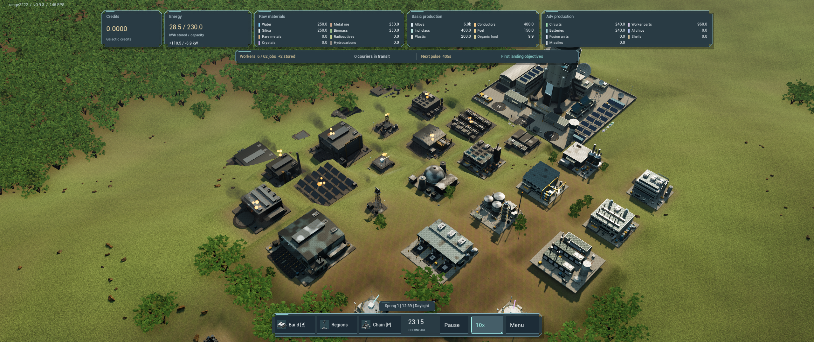
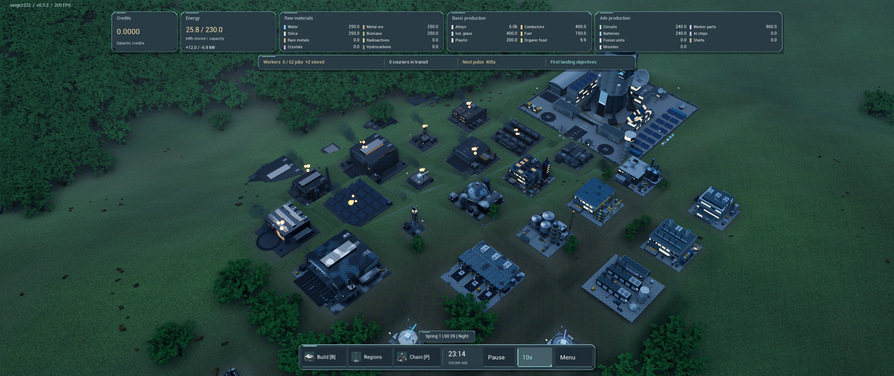
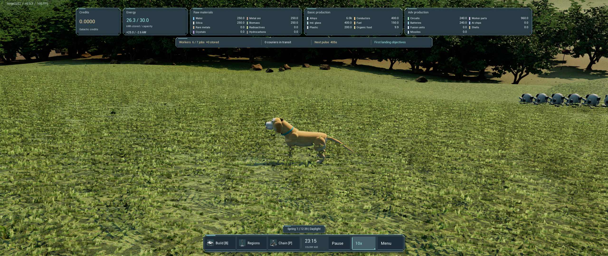

# v0.9.3 graphics and release review

Recorded 2026-10-11 from the Shipping package built at `c2c5f317fc55f6996cdb20f194b7682b5a6ac9e8`. The [release evidence](../verification/v0.9.3-local-release.json) includes report and capture hashes.

Ryzen 7 9800X3D, RTX 4070 Ti SUPER, 32 GB RAM; 3840×1600, Medium, 100% rendering resolution and 10× simulation. Each run started with no other Seige game or Unreal editor active. These are five-second samples after readiness and settling, with live streaming during travel/orbit. They are single-run diagnostics, not a sustained minimum-FPS guarantee.

| Run | View | Mean FPS | p95 frame ms | p99 frame ms | Worst frame ms |
| --- | --- | ---: | ---: | ---: | ---: |
| static | colony | 74.7 | 14.3 | 14.9 | 19.6 |
| static | meadow | 52.5 | 20.8 | 24.0 | 27.4 |
| static | ground | 52.5 | 20.7 | 21.8 | 39.0 |
| static | hills | 63.1 | 17.3 | 17.8 | 18.3 |
| static | boundary | 69.1 | 15.8 | 17.4 | 19.6 |
| travel | colony | 65.9 | 17.2 | 19.9 | 20.3 |
| travel | meadow | 51.1 | 22.3 | 23.7 | 23.9 |
| travel | ground | 51.3 | 21.3 | 23.9 | 31.1 |
| travel | hills | 59.9 | 18.6 | 20.4 | 21.4 |
| travel | boundary | 67.2 | 16.6 | 24.5 | 36.6 |
| orbit | colony | 70.5 | 16.3 | 19.1 | 19.8 |
| orbit | meadow | 55.0 | 23.0 | 23.7 | 24.4 |
| orbit | ground | 54.0 | 21.9 | 22.6 | 23.4 |
| orbit | hills | 60.3 | 20.6 | 22.0 | 23.8 |
| orbit | boundary | 65.3 | 18.7 | 20.1 | 20.2 |
| winter-neighbors | colony | 1.7 | 729.0 | 729.0 | 729.0 |

Display validation passed native 3840×1600 borderless, 1280×720 windowed, 75% internal rendering and restoration to native borderless. Test settings were not saved over player preferences.

The daytime/nighttime campus and damage fixtures render with the complete integrated building kit. The visual review also checked the original authored Rex fallback in the packaged game. Campus screenshot framing crops the shuttle tip; it is not a missing-mesh defect. The showcase is an authored review fixture rather than a balanced player save.

Visible limits remain: repeated ground patterns, foliage card edges at close range, night noise/aliasing and the stylized Rex silhouette and smooth coat. These captures do not demonstrate Manor Lords visual parity or accurate photographic likeness.

